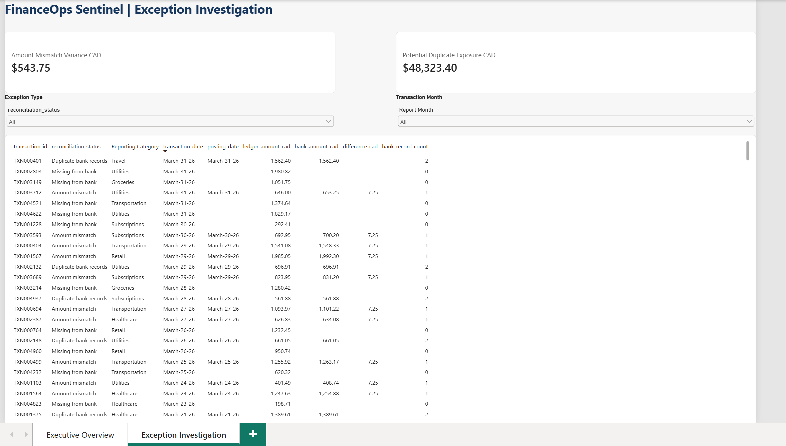
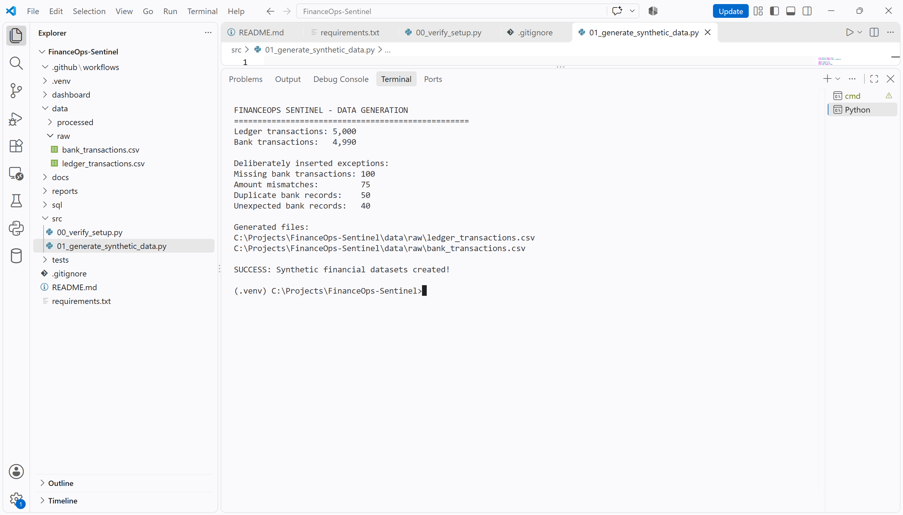
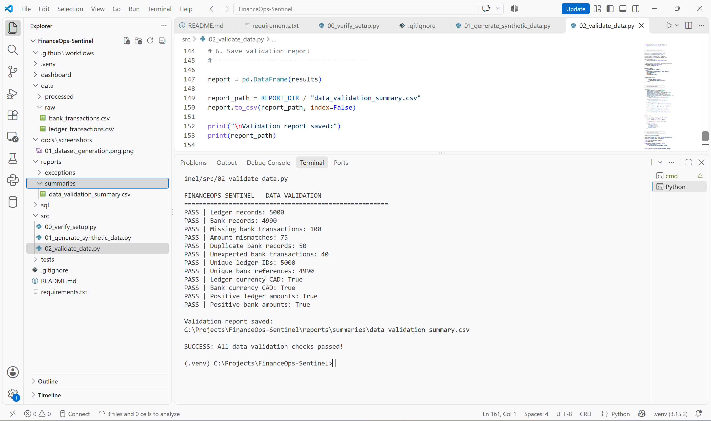
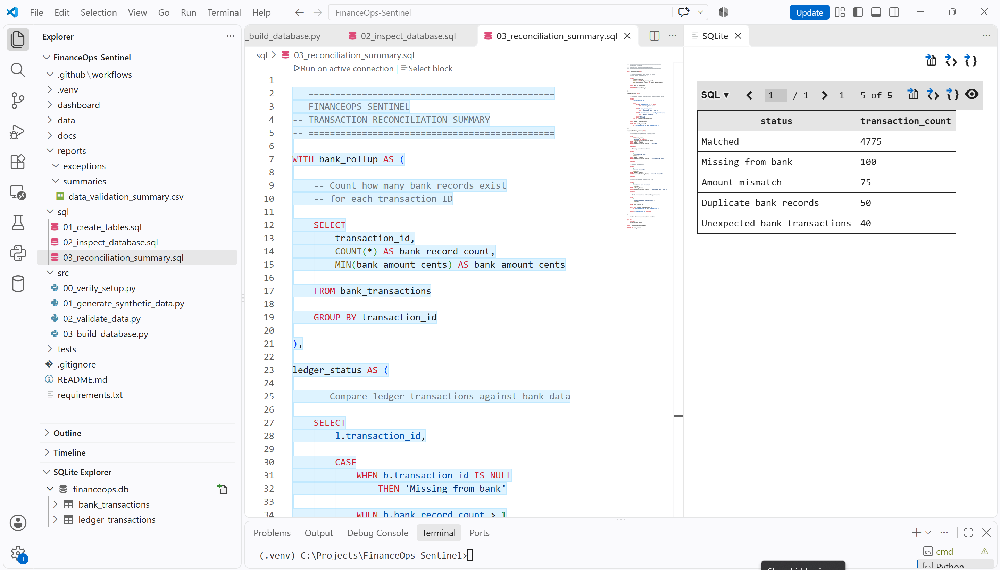
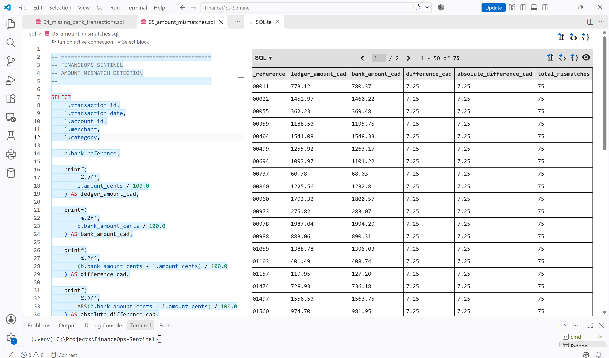
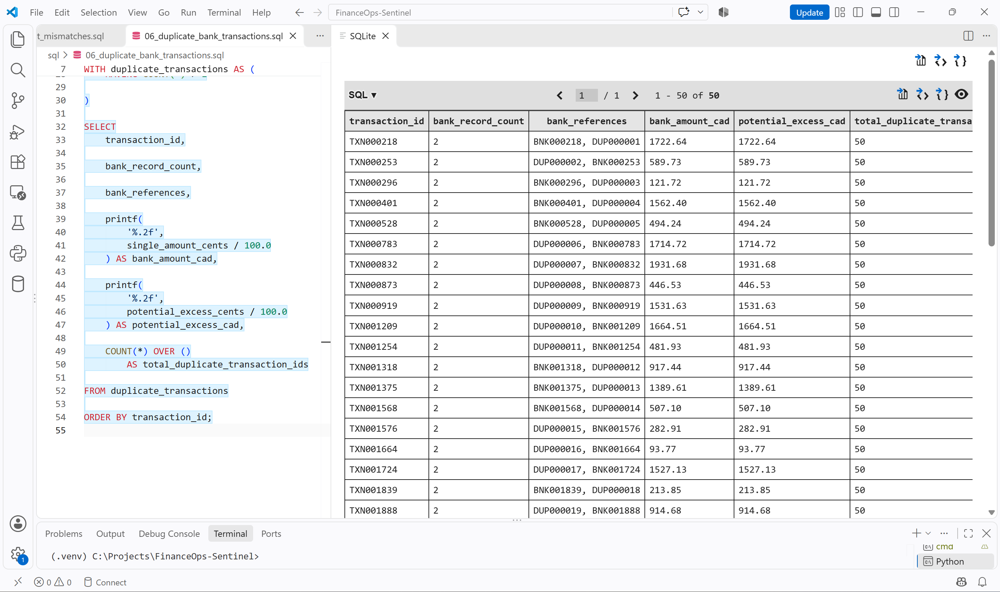
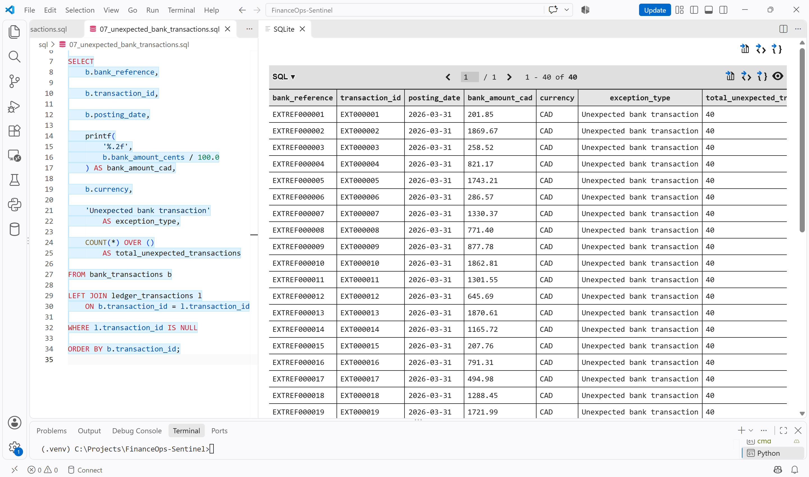
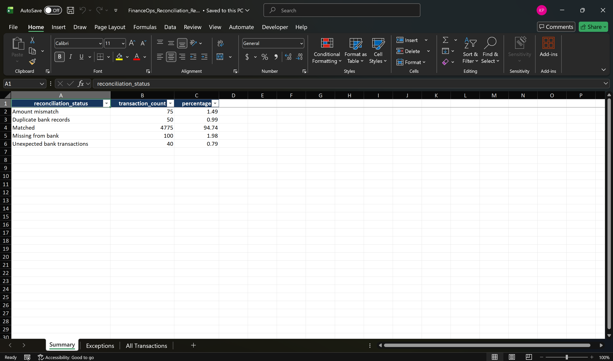
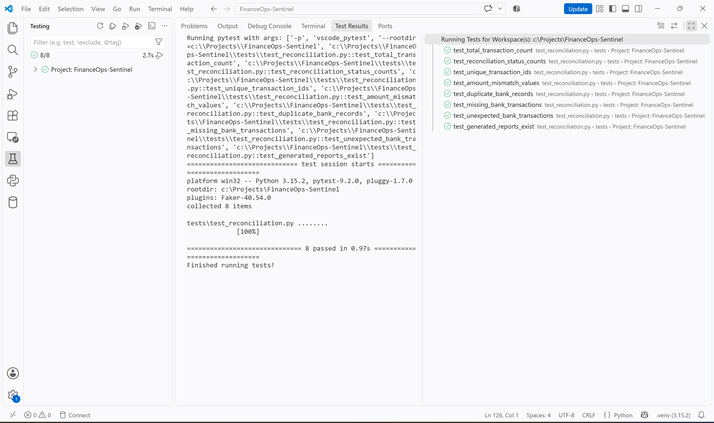

# FinanceOps Sentinel

**Automated Financial Reconciliation & Exception Monitoring**  
*Python · SQL / SQLite · Excel · Power BI · pytest · GitHub Actions*

FinanceOps Sentinel is an end-to-end analytics portfolio project that simulates transaction reconciliation for a fictional Canadian financial-services operation. It generates synthetic ledger and bank data, detects discrepancies using SQL, produces auditable exception reports, and presents the results in an interactive two-page Power BI dashboard.

**All transaction and account records are synthetic.** Financial exposure estimates indicate items for investigation—not actual losses or evidence of fraud.

## Executive overview


### Verified results

| Reconciliation metric | Result |
|---|---:|
| Ledger transactions | 5,000 |
| Bank records | 4,990 |
| Unique reconciliation records | **5,040** |
| Matched transactions | **4,775** |
| Reconciliation rate | **94.74%** |
| Missing from bank | 100 |
| Amount mismatches | 75 |
| Duplicate bank transaction IDs | 50 |
| Unexpected bank-only transactions | 40 |
| **Total exceptions requiring review** | **265** |

**Reconciliation definition:** 5,000 ledger transaction IDs plus 40 bank-only IDs yield 5,040 unique reconciliation records. The 50 duplicate bank transaction IDs are counted once each in the reconciliation results, so exception statuses are mutually exclusive. The reconciliation rate is 4,775 ÷ 5,040.

### Financial exposure indicators

| Investigation indicator | CAD |
|---|---:|
| Absolute amount-mismatch variance (75 × $7.25) | **$543.75** |
| Potential value of additional duplicate bank records | **$48,323.40** |

The duplicate exposure assumes one bank record per duplicate transaction ID is retained. Neither figure represents a confirmed financial loss.

## Exception investigation dashboard



The [Power BI report](dashboard/FinanceOps_Sentinel_Dashboard.pbix) contains two pages:

- **Executive Overview:** transaction volumes, matched rate, exception categories, monthly exception trend, category analysis, and interactive slicers.
- **Exception Investigation:** financial exposure KPIs, transaction-level exception details, and filters by exception type and reporting month.

The `.pbix` file includes an imported data snapshot. To refresh the data on another computer, point Power BI's CSV data source to the locally generated `reports/summaries/reconciliation_details.csv` using **Transform data → Data source settings**.

## Pipeline and technical approach

```text
Seeded synthetic ledger + bank records
                  |
           Python validation
                  |
       SQLite ingestion (amounts in cents)
                  |
         SQL reconciliation rules
                  |
       CSV + formatted Excel reporting
                  |
         Power BI + DAX analysis
                  |
        pytest + GitHub Actions CI
```

| Stage | Implementation |
|---|---|
| **Generate** | Seeded, repeatable synthetic records with intentional missing transactions, mismatches, duplicates, and bank-only entries (`src/01_generate_synthetic_data.py`). |
| **Validate** | Required fields, row counts, unique IDs, CAD currency, positive amounts, and expected discrepancies (`src/02_validate_data.py`). |
| **Store** | SQLite schema with constraints and indexes; monetary values converted to integer cents before insertion (`sql/01_create_tables.sql`, `src/03_build_database.py`). |
| **Reconcile** | Bank-record aggregation, `LEFT JOIN`, `CASE` classification, and detailed exception queries (`sql/03_reconciliation_summary.sql`–`sql/08_reconciliation_details.sql`). |
| **Report** | Automated reconciliation detail, summary, exception CSVs, and a formatted three-sheet Excel workbook (`src/04_generate_reconciliation_reports.py`). |
| **Test** | Eight pytest checks covering counts, classifications, expected mismatch values, duplicate counts, and report artifacts (`tests/test_reconciliation.py`). |
| **Automate** | GitHub Actions workflow configured to regenerate data, build the database, produce reports, and run tests (`.github/workflows/financeops-ci.yml`). |

### Reconciliation rules

A ledger transaction is classified in this order: **missing from bank → duplicate bank records → amount mismatch → matched**. Bank-only transaction IDs are added separately as **unexpected bank transactions**. This precedence produces mutually exclusive categories and prevents duplicate bank rows from inflating the reconciliation record count.

## Implementation evidence

The screenshots below document the working pipeline and its intermediate outputs, not just the final dashboard.

### 1. Data generation and quality controls

| Synthetic dataset generation | Dataset validation |
|:---:|:---:|
|  |  |

### 2. SQL reconciliation and amount analysis

| Reconciliation summary | Amount-mismatch investigation |
|:---:|:---:|
|  |  |

### 3. Duplicate and bank-only exception detection

| Duplicate bank records | Unexpected bank-only transactions |
|:---:|:---:|
|  |  |

### 4. Automated reporting and tests

| Formatted Excel reconciliation report | Automated pytest results |
|:---:|:---:|
|  |  |

## Repository contents

| Location | Contents |
|---|---|
| [`src/`](src/) | Four pipeline scripts: generate, validate, build, report |
| [`sql/`](sql/) | Database schema, reconciliation summary, and exception queries |
| [`tests/`](tests/) | Eight automated reconciliation tests |
| [`data/raw/`](data/raw/) | Synthetic ledger and bank CSV inputs |
| [`reports/summaries/`](reports/summaries/) | Validation, reconciliation, and Excel outputs |
| [`reports/exceptions/`](reports/exceptions/) | Transaction-level financial exception CSV |
| [`dashboard/`](dashboard/) | Two-page Power BI `.pbix` report |
| [`docs/screenshots/`](docs/screenshots/) | Ten screenshots documenting the implementation |
| [`.github/workflows/`](.github/workflows/) | Continuous-integration workflow |

## Reproduce the project

**Prerequisites:** Python 3.13+ and the dependencies in [`requirements.txt`](requirements.txt); Power BI Desktop is needed to open the `.pbix` file.

1. Open the repository folder in **VS Code** and create/select a project virtual environment.
2. Install dependencies from `requirements.txt` using VS Code's Python Environments package management interface or your preferred package installer.
3. Run the following scripts **in order** using **Run Python File**:

   ```text
   src/01_generate_synthetic_data.py
   src/02_validate_data.py
   src/03_build_database.py
   src/04_generate_reconciliation_reports.py
   ```

4. Open the generated files in `reports/summaries/` and `reports/exceptions/`.
5. In VS Code, select **Python: Configure Tests → pytest**, choose `tests/`, and run all tests from the Testing panel.
6. Open [`FinanceOps_Sentinel_Dashboard.pbix`](dashboard/FinanceOps_Sentinel_Dashboard.pbix) in Power BI Desktop; update the CSV source path if refreshing on another computer.

The GitHub Actions workflow is configured to perform the Python pipeline and tests for pushes and pull requests to `main`. **Confirm the hosted workflow's actual status in your repository's Actions tab**; local test success does not imply a successful hosted run.

## Scope and limitations

- **Demonstration only:** no live banking API, production account records, or personal banking information.
- **Matching logic:** transaction-ID-based reconciliation; real implementations may require tolerances, composite keys, settlement windows, and human review workflows.
- **Controlled data:** exception totals are deliberately seeded for repeatable verification. Tests validate this scenario rather than all production edge cases.
- **Local artifacts:** the SQLite database is generated on execution and is excluded from Git; rebuilding the database replaces its existing transaction tables.
- **Reporting interpretation:** unique reconciliation records—not raw bank rows—form the denominator of the 94.74% matched rate.
