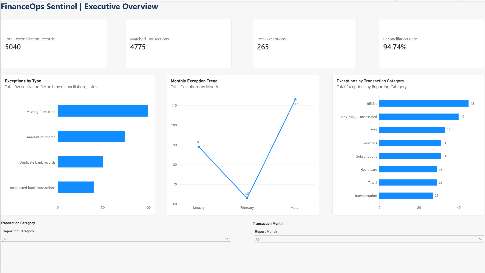

# FinanceOps Sentinel

**Automated financial reconciliation and exception monitoring** using Python, SQLite, Excel, and Power BI.

This portfolio project simulates a Canadian financial-services reconciliation workflow: generate ledger and bank transaction records, introduce known discrepancies, reconcile the sources, and produce review-ready exception reports. **All transaction data is synthetic.**

## Results

| Metric | Verified result |
|---|---:|
| Ledger transactions | 5,000 |
| Bank records | 4,990 |
| Unique reconciliation records | 5,040 |
| Matched | 4,775 |
| Reconciliation rate | 94.74% |
| Missing from bank | 100 |
| Amount mismatches | 75 |
| Duplicate bank transaction IDs | 50 |
| Unexpected bank-only transactions | 40 |
| **Total exceptions** | **265** |

Reconciliation records comprise **5,000 ledger transaction IDs + 40 bank-only IDs**. The 50 duplicate bank IDs are classified once each rather than added as separate reconciliation records. The four exception categories are mutually exclusive.

### Financial exposure indicators

- **CAD $543.75** — total absolute amount-mismatch variance (75 transactions × CAD $7.25).
- **CAD $48,323.40** — value of additional duplicated bank records, assuming one record per duplicate transaction ID should be retained.

These are **investigation indicators, not established losses or proof of fraud**.

## What the project does

```text
Synthetic ledger + bank CSV files
              |
       Python validation
              |
       SQLite ingestion
              |
      SQL reconciliation
              |
    CSV and Excel reports
              |
      Power BI dashboards
```

- **Data generation:** Seeded simulation of ledger and bank records, including deliberately inserted missing, duplicate, mismatched, and bank-only transactions (`src/01_generate_synthetic_data.py`).
- **Validation:** Required columns, record counts, currency, amounts, and known exception counts (`src/02_validate_data.py`).
- **Database:** SQLite tables with constraints and indexes; monetary values stored as **integer cents** (`sql/01_create_tables.sql`, `src/03_build_database.py`).
- **Reconciliation:** SQL joins, bank-record aggregation, exception classification, and transaction-level details (`sql/03_reconciliation_summary.sql` through `sql/08_reconciliation_details.sql`).
- **Reports:** Automated CSV outputs and a formatted three-sheet Excel workbook (`src/04_generate_reconciliation_reports.py`).
- **Tests:** Eight pytest checks of generated results, reconciliation statuses, amount differences, and report outputs (`tests/test_reconciliation.py`).

## Dashboards

**Executive Overview** — transaction volume, reconciliation rate, exception types, monthly exceptions, and category breakdowns with slicers.



**Exception Investigation** — financial-impact indicators, transaction-level details, and investigation filters.


Open [`dashboard/FinanceOps_Sentinel_Dashboard.pbix`](dashboard/FinanceOps_Sentinel_Dashboard.pbix) with **Power BI Desktop**. The report includes an imported data snapshot. To refresh it on another computer, update its CSV file path in **Transform data → Data source settings** to point to your locally generated `reports/summaries/reconciliation_details.csv`.

## Reproduce the pipeline

**Requirements:** Python 3.13 or later and packages from `requirements.txt`. Use VS Code's Python environment manager (or your preferred Python package installer) to install the dependencies. Then run these scripts **in order** using VS Code's **Run Python File** button:

1. `src/01_generate_synthetic_data.py` — generates two CSV files in `data/raw/`.
2. `src/02_validate_data.py` — validates source data and writes `reports/summaries/data_validation_summary.csv`.
3. `src/03_build_database.py` — recreates `data/processed/financeops.db` and loads both tables.
4. `src/04_generate_reconciliation_reports.py` — produces `reconciliation_summary.csv`, `reconciliation_details.csv`, `financial_exceptions.csv`, and `FinanceOps_Reconciliation_Report.xlsx`.

To run the eight automated checks, use **Python: Configure Tests → pytest** in VS Code and select the `tests` directory. The tests require the previous four scripts to have run. The GitHub Actions workflow performs these steps automatically on pushes and pull requests to `main`; its hosted run must be verified after publication.

### Main outputs

| Output | Location |
|---|---|
| SQL queries | `sql/` |
| Raw synthetic data | `data/raw/` |
| Summary and transaction reports | `reports/summaries/` |
| Exception report | `reports/exceptions/financial_exceptions.csv` |
| Power BI dashboard | `dashboard/FinanceOps_Sentinel_Dashboard.pbix` |
| Screenshots | `docs/screenshots/` |

## Scope and limitations

- This is a **synthetic demonstration**, not a live banking integration. No customer records or real bank accounts are used.
- Transactions are matched by transaction ID; production systems often require additional matching rules, timestamps, tolerances, and exception workflows.
- The provided simulation intentionally generates fixed exception totals, which make the validation results reproducible. The tests verify this scenario, not every possible real-world edge case.
- Rebuilding the SQLite database **replaces its existing tables**. Local database and Python environment files are intentionally excluded from Git.
- Reconciliation rate uses matched **unique transaction IDs divided by all 5,040 reconciliation records**, not the count of raw bank rows.

**Technology:** Python · pandas · NumPy · Faker · SQLite · SQL · openpyxl · pytest · GitHub Actions · Power BI / DAX
